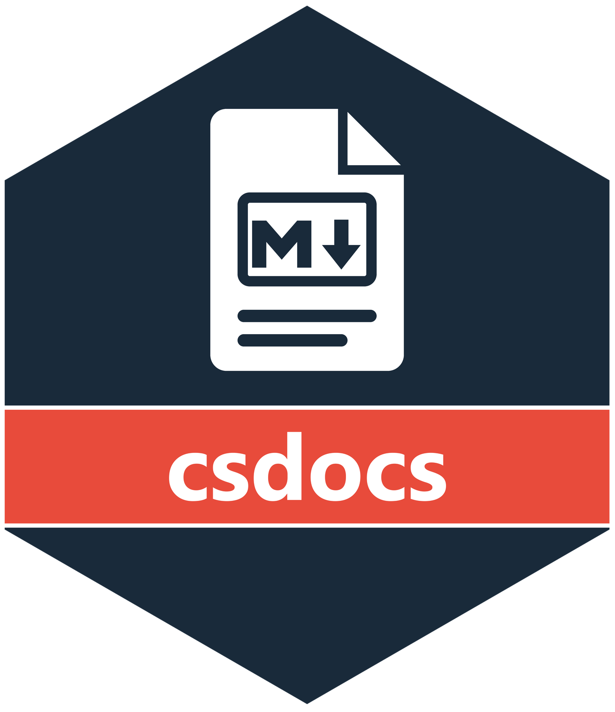

# csdocs <a href="https://niphr.github.io/csdocs/"></a>

csdocs renders the Rd documentation of an R package as plain Markdown. The output reads well on github.com and works as context for a large language model.

## Installation

```r
install.packages("csdocs", repos = c("https://niphr.r-universe.dev", "https://cloud.r-project.org"))
```

## Usage

csdocs exports three functions.

`build_reference()` writes one Markdown file per topic, a `README.md` index, and `_full_reference.md`, which holds every topic in one file. The `package` argument takes the name of an installed package or the path to a source package. For a source package, csdocs reads the documentation from the source tree and does not install the package.

```r
# An installed package
csdocs::build_reference("dplyr", output_dir = "docs/reference")

# A source package
csdocs::build_reference(".", output_dir = "docs/reference")
```

`get_documentation()` returns the content of `_full_reference.md` as one string and writes no file.

```r
docs <- csdocs::get_documentation("dplyr")
```

`build_reference()` includes documented internal topics by default (`include_private = TRUE`). `get_documentation()` includes only the public API by default (`include_private = FALSE`).

`build_site()` writes a front page, the reference and each R Markdown vignette as GitHub Markdown. The `package` argument MUST be the path to a source package. Install the package first when a vignette calls `library()` on it.

```r
csdocs::build_site(".", output_dir = "docs-build")
```

## Credit

csdocs is a fork of [pkgmd](https://github.com/peterczerner/pkgmd) by Peter Czerner, at commit `61e52b1`.
